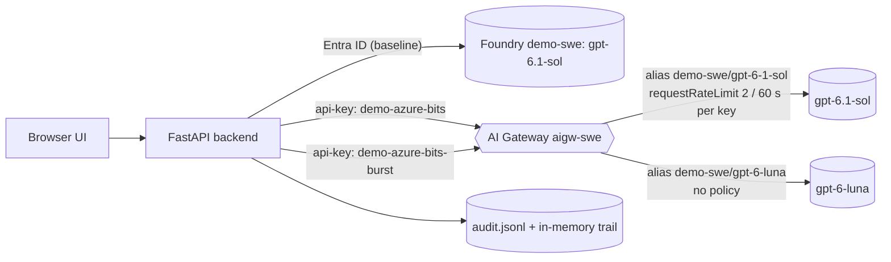

# AI Gateway governance: governed meeting-notes summarizer

A small, developer-friendly demo showing that
[Azure API Management AI Gateway](https://learn.microsoft.com/azure/api-management/ai-gateway-overview)
is a governance layer, not just a smart proxy. A meeting-notes summarizer runs the same use case two ways:

1. **Direct baseline.** The app calls `gpt-6.1-sol` directly with Entra ID. No limits, no audit,
   no fallback.
2. **Via AI Gateway.** The app calls a gateway model alias for the same `gpt-6.1-sol` deployment, using a
   dedicated runtime API key. The gateway enforces a per-key request rate limit on that alias. When the
   gateway denies the large model, the app switches to the small model (`gpt-6-luna`) and still returns a summary.

**Who does what:** the **gateway decides**. It returns HTTP 429 with the policy reason. The **app switches**
by calling the fallback alias. The gateway's native Fallback policy is a circuit breaker for backend
failures, so it does not reroute a request that a limit policy denied.

The **Run details** panel shows the outcome of every run:

- status
- requested and served model, with a fallback indicator
- policy decision, action, and who decided
- tokens, latency, and estimated cost
- the governance response headers
- links to the audit entries

The **Audit trail** shows every model call. Expanding an entry shows the request, the response headers, and the raw gateway error body.



## Demo script

Wait about 60 seconds before steps 1 and 3 so that the rate-limit window starts empty.

| Step | Input | Expected Run details (measured on the live gateway) |
| --- | --- | --- |
| 0. Baseline | Path **Direct baseline**, preset **Request 1** | `served=gpt-6.1-sol-2026-09-29`, `policy=none (no gateway)`, about 540 tokens, about 5 s |
| 1. Policy pass | Path **Via AI Gateway**, preset **Request 1** (2 paragraphs) | `requested=demo-swe/gpt-6-1-sol`, `served=gpt-6.1-sol-…`, `policy=pass`, `action=none`, about 550 tokens, about 5 s, about $0.003 |
| 2. Policy violation | Via AI Gateway: click **Summarize** on Request 1 two more times quickly, then switch to preset **Request 2** (long transcript, about 3,550 input tokens) | First call: HTTP 429 `Rate limit is exceeded` from the gateway. Second call: `demo-swe/gpt-6-luna`. Final result: `served=gpt-6-luna-…`, `policy=request_rate_limited`, `action=fallback`, `switched by=app (on gateway 429)`, `FALLBACK` flag, and two audit IDs |
| 3. Rate limit | **Run burst** with 6 parallel requests | The burst targets the limited Sol alias with key `demo-azure-bits-burst`. Measured: 3 × 200, 3 × 429 (`retry-after: 30`), each with the same normalized error. The control request with key `demo-azure-bits` still returns 200 |

Measured difference for the long transcript: on Sol about 4,700 tokens, 17–20 s, and $0.012–0.020;
after the fallback on Luna about 4,000 tokens, about 5 s, and about $0.0006. Each value is a single
observation, not a benchmark.

### Fairness of the comparison

Both tiers receive **the same input text**. Both models are reasoning models: they get
`reasoning_effort=low` and their default temperature, because they reject any other temperature.
The output caps (`max_completion_tokens`) include reasoning tokens. The baseline and the gateway's
primary alias use the same `gpt-6.1-sol` deployment. The difference is deliberate and visible
in the UI and in each audit entry (`promptProfile`):

- **Large / structured** (`gpt-6.1-sol`, max 2,500 completion tokens):
  „Jsi asistent pro shrnutí meeting notes. Vytvoř strukturované shrnutí: Kontext, Klíčová rozhodnutí,
  Akční položky s vlastníky a termíny, Rizika. Použij krátké věty, maximálně 8 bodů. Pokud něco chybí,
  explicitně to uveď jako ‘Nezadáno’."
- **Small / concise** (`gpt-6-luna`, max 1,200 completion tokens):
  „Shrň text do 3 krátkých odstavců: Co se řešilo, Co se rozhodlo, Co je další krok. Nepřidávej žádné
  vymyšlené detaily. Buď stručný."

The long-transcript preset starts with the limit-test instruction „Z tohoto textu vytvoř detailní zápis,
přepiš ho do přehledné struktury, navrhni alternativy a přidej doporučení." It is followed by a long
transcript sized to exceed a token policy reliably, if you add one (see step 3 of the gateway configuration).

## How the app interprets gateway answers

| Gateway answer on the primary alias | `policy` | `action` | Who switched |
| --- | --- | --- | --- |
| 200, response `model` is the large model | `pass` | `none` | — |
| 200, response `model` is the small model | `rerouted_by_gateway` | `fallback` | gateway |
| 429 that mentions tokens or has `remaining-tokens`/`consumed-tokens` headers | `token_limit_exceeded` | `fallback` | app, on gateway deny |
| 429 that mentions cost or budget | `cost_limit_exceeded` | `fallback` | app, on gateway deny |
| Any other 429 | `request_rate_limited` | `fallback` if listed in `FALLBACK_ON`, otherwise `reject` | app, on gateway deny |
| 400 content safety, 401, 403, 404, 5xx | specific code | `reject` | — |

`FALLBACK_ON` in `.env.example` includes `request_rate_limited`, because the primary alias in this setup
has only a request rate limit. Remove it to show a plain rejection instead of a fallback.

The app identifies the served model from the response `model` field, matching the longest
configured model ID first. Every rejection returned to the client has the same envelope (a real burst rejection):

```json
{
  "error": {
    "code": "request_rate_limited",
    "httpStatus": 429,
    "message": "Rate limit is exceeded. Try again in 30 seconds.",
    "retryAfterSeconds": 30,
    "source": "ai-gateway",
    "correlationId": "burst-af63ada5-1"
  }
}
```

The audit entry for the correlation ID keeps the original gateway body and headers as evidence.

## Configure the AI Gateway (manual, Azure portal)

This demo does **not** change the gateway. The gateway is not managed with Terraform yet. Configure it manually in the
Azure portal on the existing AI Gateway `aigw-swe` (resource group `rg-ai`, Sweden Central), in the
`default` workspace. The resource type is `Microsoft.ApiManagement/aigateways`.

1. **Model alias `demo-swe/gpt-6-1-sol` (primary, large).**
   - Backend model: provider `demo-swe`, deployment `gpt-6.1-sol`.
   - Inline policy **Request rate limit**: `2` calls per `60` seconds, counter key `identity` (per API key).
2. **Model alias `demo-swe/gpt-6-luna` (fallback, small).** Backend deployment `gpt-6-luna`, no policy.
3. **Optional: token limit for a length-based Request 2.** Add an inline **Token limit** to the Sol alias,
   for example `3000` tokens per minute. The short notes use about 550 tokens per run and the long
   transcript about 3,550 input tokens, so Request 2 then fails with `policy=token_limit_exceeded`
   instead of `request_rate_limited`. The app already falls back on both.
4. **Runtime API keys.** Create two dedicated keys. Do not reuse `master`.
   - `demo-azure-bits`: used for normal summarize calls and the burst control request.
   - `demo-azure-bits-burst`: used only by the Request 3 burst.
5. **Optional: observability.** Add a telemetry exporter, either Application Insights or OTLP. The gateway emits
   the `gen_ai_client_token_usage` metric with the attributes `gen_ai.request.model`, `gen_ai.response.model`,
   and `gen_ai.token.type`. The app sends `x-correlation-id` on every call so that you can join gateway
   telemetry to the app's audit entries. Example PromQL:

   ```promql
   sum by (gen_ai_request_model, gen_ai_response_model) (gen_ai_client_token_usage)
   ```

6. **Optional: gateway-native routing.** You can create a third alias with Sol at priority 0,
   Luna at priority 1, and a **Fallback** policy. Set `GATEWAY_PRIMARY_MODEL` to that alias.
   If the gateway serves the request from Luna, the app shows `policy=rerouted_by_gateway` and
   `switched_by=gateway`.

### Observed gateway behaviour

These AI Gateway tier features are in preview. The following was observed on the live gateway:

- **The request rate limit is counted per API key.** After the app key was throttled, the burst key still
  got three successful calls in a row.
- **A limit of "2 per 60 s" allowed about 3 calls** per key before returning 429. Treat the limit as
  approximate and send one more request than the configured count.
- **Rejected requests count as well.** Calls that fail with HTTP 400 (for example, an unsupported parameter)
  consume the limit.
- **The 429 body** is `{"statusCode": 429, "message": "Rate limit is exceeded. Try again in N seconds."}`
  with a `retry-after` header and no token headers. The app classifies it as `request_rate_limited`.
- **The burst control request consumes one of the app key's slots.** Wait about 60 seconds after a burst
  before running step 1 again.
- **Model parameters:** `gpt-6.1-sol` and `gpt-6-luna` reject `max_tokens` and any non-default
  `temperature`. The app always sends `max_completion_tokens` and omits `temperature` when it is empty.

## Prerequisites

- Python 3.12 or later
- Azure CLI signed in to the tenant that hosts `demo-swe` (for the direct baseline). The signed-in user needs
  the **Cognitive Services OpenAI User** role on that resource.
- The gateway configuration above, and the two runtime key values

## Configuration

Copy `.env.example` to `.env` and fill in `GATEWAY_APP_KEY` and `GATEWAY_BURST_KEY`. If the keys are
empty, only the direct baseline works, and the UI shows `not configured`.

| Variable | `.env.example` value | Purpose |
| --- | --- | --- |
| `FOUNDRY_OPENAI_ENDPOINT` | `https://demo-swe.openai.azure.com` | Direct baseline endpoint, called with Entra ID |
| `DIRECT_LARGE_DEPLOYMENT` | `gpt-6.1-sol` | Deployment used by the baseline |
| `GATEWAY_ENDPOINT` | `https://aigw-swe…` | AI Gateway runtime URL. The app calls `/default/models/openai/v1/chat/completions` |
| `GATEWAY_PRIMARY_MODEL` / `GATEWAY_FALLBACK_MODEL` | `demo-swe/gpt-6-1-sol` / `demo-swe/gpt-6-luna` | Gateway aliases |
| `GATEWAY_APP_KEY` / `GATEWAY_BURST_KEY` | — | Runtime key values. Used only in the backend and never logged |
| `GATEWAY_APP_KEY_NAME` / `GATEWAY_BURST_KEY_NAME` | `demo-azure-bits` / `demo-azure-bits-burst` | Key names shown in the UI and the audit trail |
| `GATEWAY_BURST_MODEL` | empty (primary alias) | Alias the burst targets |
| `FALLBACK_ON` | `token_limit_exceeded,cost_limit_exceeded,request_rate_limited` | Gateway decisions that trigger the fallback call |
| `LARGE_MODEL_ID` / `SMALL_MODEL_ID` | `gpt-6.1-sol` / `gpt-6-luna` | Prefixes used to identify the served model |
| `LARGE_MAX_OUTPUT_TOKENS` / `SMALL_MAX_OUTPUT_TOKENS` | `2500` / `1200` | Sent as `max_completion_tokens`; includes reasoning tokens |
| `LARGE_TEMPERATURE` / `SMALL_TEMPERATURE` | empty | Empty omits the parameter. Set it only for models that accept it |
| `LARGE_REASONING_EFFORT` / `SMALL_REASONING_EFFORT` | `low` / `low` | Empty omits the parameter |
| `*_PRICE_*_PER_1M` | Global Standard list prices in USD from the Azure Retail Prices API | Inputs for the cost estimate. Cache-write charges are not included |
| `AUDIT_LOG_PATH` | `logs/audit.jsonl` | Append-only audit file. Ignored by Git |

### Authentication note

The repository standard is managed identity. The AI Gateway runtime supports Entra ID, but the
gateway's Entra application cannot be used in this tenant (`AADSTS7000118`). This demo therefore uses
**dedicated, per-client runtime API keys**. The keys exist only in the backend environment (`.env`
locally) and are never sent to the browser. The audit trail and API responses contain only key
*names*. Per-key keys are also what make per-client limits visible in the demo. The direct baseline
uses `AzureCliCredential`, or `ManagedIdentityCredential` when `APP_ENV=production`. The gateway reaches
Foundry with its own managed identity.

## Run locally

```sh
export AZURE_CONFIG_DIR="$HOME/.azure-365"
export AZD_CONFIG_DIR="$HOME/.azd-365"

cd ai-gateway-governance
python3.12 -m venv .venv
.venv/bin/python -m pip install \
  --index-url https://packagefeedproxy.microsoft.io/pypi/simple \
  -r requirements.txt
cp .env.example .env   # then fill in the two gateway keys
set -a
source .env
set +a
.venv/bin/uvicorn app.main:app --host 127.0.0.1 --port 8000
```

Open <http://127.0.0.1:8000>. The app has no sign-in. Keep it bound to `127.0.0.1`. Each summarize run
makes one or two billable model calls. A burst makes up to 21 very small calls.

Audit entries are also written to stdout and `logs/audit.jsonl`:

```sh
tail -f logs/audit.jsonl | python3 -m json.tool --json-lines
```

API endpoints for scripting:

| Method and path | Purpose |
| --- | --- |
| `GET /api/config` | Routes, prompts, prices, and samples. Never includes key values |
| `POST /api/summarize` `{ "text": "...", "path": "direct" \| "gateway" }` | Run details and summary |
| `POST /api/burst` `{ "count": 10 }` | Burst outcome and control request |
| `GET /api/audit`, `GET /api/audit/{correlationId}`, `DELETE /api/audit` | Audit trail |

## Validate

```sh
.venv/bin/python -m pytest -q
```

The tests mock both endpoints with `httpx.MockTransport`. They cover the following cases:

- direct baseline auth
- gateway pass
- token-limit 429 followed by fallback to the small alias
- rate-limit 429 followed by fallback when `FALLBACK_ON` includes it
- reasoning-model parameters (`max_completion_tokens`, `reasoning_effort`, omitted temperature)
- reroute by the gateway
- the rate-limit error envelope
- burst requests plus the control key
- 429 classification
- cost estimation
- input validation
- key values never appearing in the audit trail or the API
- bootstrap lock (`BOOTSTRAP_LOCKED`) and single-tenant Entra OIDC reader authentication

## Deploy to Azure

Live demo: <https://ai-gateway-governance-demo.salmonbush-57fddba4.swedencentral.azurecontainerapps.io>

Terraform in `infra/` deploys the application to a dedicated Azure Container Apps Express environment in Sweden Central (`rg-ai-gateway-governance-demo`). It creates a Basic ACR (`acraigwgovdemo`), delegated VNet subnet, user-assigned managed identity (`uami-aigw-governance-demo`), role assignments (`AcrPull` on the registry and `Cognitive Services OpenAI User` on `demo-swe`), and a scale-to-zero Container App (`ai-gateway-governance-demo`) with one maximum replica. The existing Foundry account (`demo-swe`) and AI Gateway (`aigw-swe`) remain external in `rg-ai` and are never recreated.

The deployed site uses single-tenant Entra login (`ALLOWED_USERS=tenant:*`) and stores the two AI Gateway runtime keys (`GATEWAY_APP_KEY`, `GATEWAY_BURST_KEY`) as Container App secrets.

Confirm the subscription, dedicated resource group, tenant-wide reader access, resource costs, and role-assignment authorization before applying. Ensure `GATEWAY_APP_KEY` and `GATEWAY_BURST_KEY` are set in `.env` or your shell environment, then run:

```sh
export AZURE_CONFIG_DIR="$HOME/.azure-365"
export AZD_CONFIG_DIR="$HOME/.azd-365"
export AZURE_SUBSCRIPTION_ID="<approved-subscription-id>"
export ENTRA_TENANT_ID="<approved-tenant-id>"

cd ai-gateway-governance
./scripts/deploy.sh
```

The script verifies the existing `demo-swe` deployments and `aigw-swe` gateway, applies Terraform in two stages, builds an immutable image in ACR, discovers the generated HTTPS hostname, creates or reuses a single-tenant Entra application, injects the OIDC and gateway secrets into the Container App, restarts the Express app so secret changes take effect, and verifies `environmentMode: Express`, managed identity bindings, scale `0..1`, `/healthz`, and the unauthenticated Entra login redirect.

