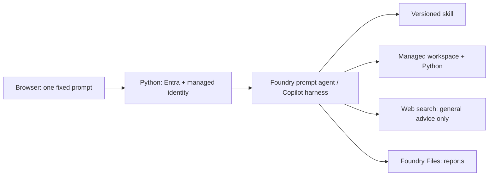

# Foundry Copilot harness: workshop planner

A small Czech-language demo of **one prompt -> skill -> tools -> result**.
The agent compares three fictional workshop offers, executes a versioned Python
calculation in Foundry's managed sandbox, searches for general facilitation
advice and produces a recommendation and reports. The user clicks one button;
there is no arbitrary prompt input.

**Deployment status:** activated after explicit approval. The deployed YAML
agent exercised its skill, CSV read, shell/Python, web search and report upload
in a real managed-identity run. The live smoke passed with a verified budget,
three report references and no missing-evidence warnings.

**Live demo:** <https://foundry-copilot-harness-demo.mangoplant-89bf92cc.swedencentral.azurecontainerapps.io>

Sign in with any account in the configured Entra tenant. The explicit policy
is `ALLOWED_USERS=tenant:*`, matching the other demos. This is not anonymous
access: Entra still validates the signature, issuer, audience, nonce and tenant
before creating a signed reader session. Accounts from other tenants are rejected.
An empty allowlist still denies everyone; individual `entra:<oid>` entries remain
supported for a restricted deployment. Report links remain bound to their reader.
Anonymous API calls return 401; assets redirect to sign-in. The upload API
is disabled (404), and its temporary Contributor assignment has been removed.
Actual tenant/out-of-tenant interactive account login remains a user verification step;
the automated browser reached the real Entra sign-in page, not a completed login.

## What this demonstrates

| Building block | In this demo |
| --- | --- |
| Model | Existing `gpt-5.4` deployment decides which step to take |
| Harness | Foundry operates the loop, conversation workspace and sandbox |
| Skill | `skills/workshop-planner/SKILL.md` describes a repeatable procedure |
| Tools | File read/write, shell for Python, and a separate `web_search` tool |
| Source control | `azure.yaml`, skill, script, data and prompt live together |
| App | Python transports Responses events; it does not implement an agent loop |

GitHub Copilot helps author and change these files. Runtime execution happens in
**Microsoft Foundry**, not in a local Copilot process. The harness is a preview
capability of a prompt agent, not a hosted agent or customer-managed container.
Subagents, MCP servers, Toolboxes and a separate Code Interpreter are deliberately
omitted: they are unnecessary for understanding this example.



## Scenario

12 participants, one day in Prague, a projector, CZK 25,000 including a 10%
contingency. All venues, offers and prices are fictional, final CZK amounts.

| Offer | Base cost | With contingency | Decision |
| --- | --- | --- | --- |
| A / Atelier A | 19,200 | 21,120 | Eligible; winner |
| B / Forum B | 24,400 | 26,840 | Over budget |
| C / Studio C | 14,000 | 15,400 | Capacity 10; no projector |

Formula: `(rental + 12 * catering_per_person) * 1.10`, using `Decimal`.
The Python script validates input, rejects malformed/negative/nonfinite amounts
and chooses the lowest eligible total with offer ID as a deterministic tie-breaker.

Web search supplies two **general** workshop tips with citations. It never
looks up fictional venues, changes prices, books anything or contacts anyone.
An unavailable search is an explicit incomplete section, not invented evidence.

## Prerequisites

- Python 3.13, Node.js for frontend tests and Terraform 1.6+.
- Signed-in Azure CLI and azd 1.37.0+ with Foundry extensions:
  agents beta.22+, projects beta.15+ and skills beta.9+ (1.0.0 also works).
- Existing `demo-swe/demo-swe-prj` in `rg-ai`, Sweden Central, and `gpt-5.4`.
- Existing Express environment `foundry-mai-audio-env`, registry/storage
  `maiaudio7bc68`, private Blob networking and user-assigned identity
  `foundry-mai-audio-identity` in `rg-foundry-mai-audio-demo`.
- Existing single-tenant Entra reader registration and explicit `tenant:*` policy.

Set these for **every** Azure/azd/Terraform shell:

```bash
export AZURE_CONFIG_DIR="$HOME/.azure-365"
export AZD_CONFIG_DIR="$HOME/.azd-365"
export AZD_ALPHA_ENABLE_AGENTS_MANAGED_HARNESS=true
```

The implementation used a session-local azd 1.37.3, leaving the global azd
executable unchanged, and updated the Foundry extension bundle to 1.0.0.
Set `AZD_BIN` to a compatible executable when the global one is older.

## Run locally

```bash
cd foundry-copilot-harness
python3.13 -m venv .venv
.venv/bin/python -m pip install \
  --index-url https://packagefeedproxy.microsoft.io/pypi/simple -r requirements.lock
cd app
LOCAL_DEV=true LIVE_DEMO_ENABLED=false APP_ENV=development \
  ../.venv/bin/uvicorn main:create_app --factory --host 127.0.0.1 --port 8027
```

Open <http://127.0.0.1:8027>. This is a **static preview**: the live button is
disabled and no Azure credential is attempted. A Mac's Azure CLI login is only
for administration, never a workload-authentication fallback. Live requests use
`ManagedIdentityCredential` on Azure. No API keys, storage keys or workload
client secrets are supported.

## Publish the agent from YAML

From the demo folder, with the Azure variables above:

```bash
export FOUNDRY_PROJECT_URL=https://demo-swe.services.ai.azure.com/api/projects/demo-swe-prj
export MODEL_DEPLOYMENT_NAME=gpt-5.4
azd env new harness-demo --subscription 7bc68c68-f434-49ad-ab3e-b883ec39da86 \
  --location swedencentral --no-prompt
bash scripts/deploy-agent.sh --check
bash scripts/deploy-agent.sh --deploy
```

Skip `env new` if the local environment already exists. `--check` is a read-only
manifest/target check, **not** a cloud deployment preview. These azd prompt/skill
hosts do not implement `deploy --preview`. `--deploy` sets both the repository's
`FOUNDRY_PROJECT_URL` and the skill extension's `FOUNDRY_PROJECT_ENDPOINT`.
It uses `azd deploy`, never `azd up` or `azd provision`.
`AZURE_RESOURCE_GROUP=rg-ai` belongs to the existing agent project; it is not the
web application's new RG.

Deployment creates immutable skill/agent versions. The initial deployed agent
is `workshop-planner-demo`, version `1`, referencing skill `workshop-planner`,
version `2` (a failed CLI attempt had already published version `1`).
Inspect the persisted definition and active status with `azd ai agent show
workshop-agent --output json`. Changing the harness of an existing non-harness
agent is not supported.

## Deploy the web app

The Terraform configuration owns only the **new** RG/app and optionally the
explicit agent file-access role. Shared resources are read-only references.
The existing workload identity already succeeded at creating conversations and
invoking the agent with its current roles; no additional workload role is needed.

```bash
az acr build --registry maiaudio7bc68 \
  --image copilot-harness:<unique-tag> --file Dockerfile .
cd infra
terraform init
terraform plan \
  -var='container_image=maiaudio7bc68.azurecr.io/copilot-harness@sha256:<reviewed-digest>' \
  -var='agent_principal_id=<principal-from-agent-instance_identity>' \
  -out=bootstrap.tfplan
terraform apply bootstrap.tfplan
```

The initial app is locked: health is available, reader requests return 503 and
every upload-management method returns 404.
Cross-RG reuse of the existing Express environment and identity was verified
by successful deployment. Scaling is configured at min 0 / max 1, but actual
idle scale-to-zero behavior has not been measured.

**The following steps change permissions/configuration and require approval:**

1. Review a new Terraform plan with `-var=approve_role_assignments=true`.
   It adds only **Foundry User** (`53ca6127-db72-4b80-b1b0-d745d6d5456d`) for
   the **agent's** `instance_identity.principal_id` at the existing project.
   The initial agent principal is `8ed39c88-a3ce-4e47-9ceb-04df72cdfc61`.
   Apply that reviewed plan only after approval. Allow RBAC propagation.
   Keep `approve_role_assignments=true` in the subsequent Terraform configuration:
   reverting it to false would plan deletion of this role. This activated checkout
   records the approved flag, agent principal and image in ignored `terraform.tfvars`.
2. Run `.venv/bin/python scripts/configure-app.py --approve-reader-changes
   --agent-version 1`. It preserves existing redirect URIs, adds this app's
   actual callback to the existing registration and copies its current
   reader allowlist/reader credential in memory into the new app. It creates a
   fresh session key; credentials never appear in argv, logs or Terraform state.
   Reader OAuth is separate from workload managed identity.
3. Run `.venv/bin/python scripts/publish-assets.py --approve-publish-role`.
   It grants temporary container-scoped Blob Contributor to the existing
   identity, uses the authenticated upload relay and always attempts to disable
   the relay and remove that exact assignment. A recovery marker is retained
   on failure; use `--recover` before another publish.
   The checkout's recovery marker is also its exclusive local lock. Coordinate
   a single operator across checkouts; do not overlap publishing or deployment.
   Publishing also verifies invalid credentials, HEAD/ranges, an oversized
   upload preserving the prior blob, and exact create/overwrite/delete with a
   temporary `publish-check.txt` inside this demo's prefix.
4. Run `bash scripts/smoke-cloud.sh`. This invokes the in-container smoke through
   managed identity and fails unless the explicit `LIVE_SMOKE_PASSED` marker is
   present. Azure CLI exec's exit status alone is not reliable.
5. Verify a tenant account and an out-of-tenant account in the actual browser.

The storage account stays public-network-disabled, shared-key-disabled and
non-anonymous. Assets are Cool-tier blobs under `site/copilot-harness/v1/`.
The bundled publishing/storage adapter is confined to that prefix, so it
cannot overwrite the audio demo's content. No extra storage/network service
is created. Source files are excluded from asset uploads; frontend assets are
excluded from the backend image.

To update a reviewed backend image while preserving configuration:

```bash
.venv/bin/python scripts/deploy-image.py \
  maiaudio7bc68.azurecr.io/copilot-harness@sha256:<reviewed-digest>
```

Express updates can require application stop/start. The helper uses bounded
retries for `ContainerAppOperationInProgress`, then checks health. Terraform
ignores the app's runtime body after creation so reader secrets/configuration
are managed without copying them into state.
The helper reads existing secret values only in memory before a full ARM patch;
Azure's GET returns secret names alone, which cannot be blindly echoed into PATCH.

## Runtime contract and limitations

- `FOUNDRY_AGENT_VERSION` is required. Each run verifies the deployed latest
  version against it before invocation. This SDK does not expose a documented
  fixed-version agent endpoint: do not change the active agent during a run.
- Each run uses a new conversation and the **agent-scoped Responses endpoint**.
  Input CSV is sent inline as a file, not interpolated into instructions.
  Project-scoped file operations download durable Foundry Files.
- One active run per replica; 30-second start cooldown; exact Origin + session
  CSRF checks; no automatic model retry. The API accepts only an empty object,
  not a user-provided prompt.
- The five-minute application deadline is a wait limit, **not** a guaranteed
  server-side cost cap. Cleanup deletes the conversation, including after
  disconnect; failures are logged with its ID. Do not retry an uncertain run
  blindly. Per-run client cooldown state resets if the replica restarts.
- Only actual returned tool events are displayed; reasoning text/arguments
  are not exposed. The app marks missing tool evidence explicitly.
- A report is marked verified only when the returned `budget.json` equals the
  independent deterministic result. Missing report uploads are visible errors,
  never a success-shaped fallback. Reports are attachment-only downloads behind
  reader-bound, one-hour signed links.
- Report file references and generated files are durable in Foundry, but the
  web UI has no history database. The browser does not persist results.
- Harness tool restrictions are not a security sandbox policy: shell is broad.
  Use this only with the fixed fictional scenario and reviewed skill.
- Model inference, web search, storage/retrieval, registry builds and application
  compute can incur charges. The launch blog says harness runtime billing
  begins December 1, 2026. Token usage is returned when provided, not converted
  into an invented total price.

## Validation and observed evidence

```bash
.venv/bin/python -m pytest -q
node --test tests/frontend.test.mjs
terraform -chdir=infra validate
# With the local preview running:
playwright-cli -s=harness-demo open http://127.0.0.1:8027 --browser=chromium
playwright-cli -s=harness-demo run-code --filename=tests/browser-checks.js
```

The browser check uses **explicit test-only request mocks**, not fake-live
behavior in the application. It exercises success/error rendering, CSRF request
shape, downloads and safe text rendering. Static preview was inspected at
1440, 820, 375 and 320px widths.

The initial run explicitly reported denied Foundry Files access and an unverified
result. After approval, a **single** project-scoped Foundry User role was assigned
to the agent; no additional workload role was necessary.

The subsequent managed-identity smoke passed with `LIVE_SMOKE_PASSED`:
`skill`, `view`, `shell_call`, `web_search_call`, report creation and upload
were observed. It returned A at CZK 21,120, the exact rejection reasons for B/C,
three web citations and all three report references. Downloaded `budget.json`
matched the canonical result; `verified=true` and `warnings=[]`.

Publishing byte-verified all five assets through the private relay. Live relay
checks verified credential rejection, list/read/HEAD, overwrite, ranges, exact
delete and oversized-upload preservation. Afterwards every management method
returned 404 and the exact temporary Contributor role was absent.
In-container checks confirmed private Blob DNS and Cool tier on all five assets.
The read-only report check then downloaded all three reports: CSV (138 bytes),
JSON (813 bytes), and Markdown (1,603 bytes). JSON and CSV matched the exact
reference, and Markdown included the fictional-data label and winner.

To verify existing report downloads and private storage **without another paid
inference**, execute `python /app/app/smoke.py --files <budget-csv-id>
<budget-json-id> <recommendation-id>` inside the Container App.
This checks the JSON and CSV against the exact deterministic reference, Markdown
content and each asset's tier; success emits `FILES_AND_STORAGE_CHECK_PASSED`.
CLI exec's exit status is insufficient here too: require that marker.

Anonymous readers were denied on APIs, HEAD and all assets, and the real browser
reached Entra sign-in with the new callback. An actual allowed account and a
out-of-tenant account were not available to complete interactive sign-in.
Allowlist/OIDC handling and frontend states have separate explicit mock tests;
those are not claimed as live account-login evidence.

## Sources

- [Launch blog](https://devblogs.microsoft.com/foundry/microsoft-copilot-harness-in-foundry/)
- [Harness setup, tools, identity and files](https://learn.microsoft.com/azure/foundry/agents/how-to/use-tools-skills-copilot-harness)
- [Existing-project research quickstart](https://learn.microsoft.com/azure/foundry/agents/quickstarts/create-web-research-agent)
- [Preview regions and unsupported request settings](https://learn.microsoft.com/azure/foundry/agents/concepts/limits-quotas-regions)

Do not run `azd down` or destroy shared resources to clean up this demo.
Delete only reviewed demo-specific resources/versions and the exact role
assignment owned by this Terraform state, with explicit cleanup authorization.
